# Sid's EtherCAT Configurator — v0.1

A single-file, offline web app for visually laying out Beckhoff EtherCAT
stations and multi-vendor control panels — place devices, wire them with
automatic cable selection, validate the design, and export a bill of
materials, a wiring diagram, and a TwinCAT-style device list.

No install, no server, no account. Open one HTML file in a browser.

> **Design aid, not an engineering tool.** Specs are partly approximate and
> partly representative defaults — see [Status & accuracy](#status--accuracy)
> and [Data sources & attribution](#data-sources--attribution) before relying
> on anything here.

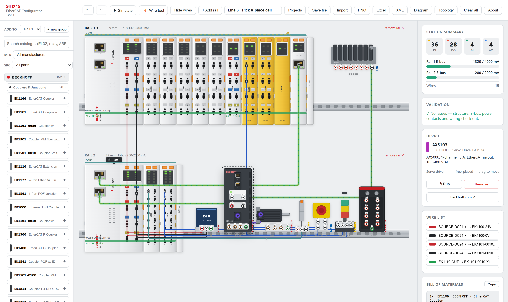

## Screenshots

Every image below is generated from the real app by
[`scripts/shots`](scripts/shots/) — see [Regenerating screenshots](#regenerating-screenshots).

**Wiring.** Press two connection points and the right cable is chosen for you.
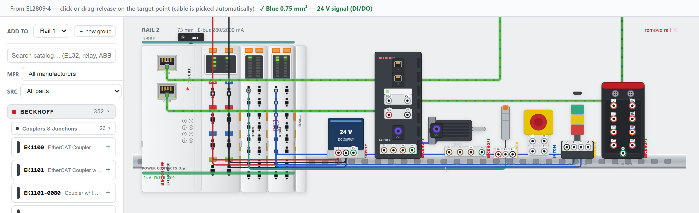

**Simulate** *(v0.2, in development)*. A simulated EtherCAT master runs a
Structured Text program over the drawing: the sensor turns on its input,
the PLC switches an output, and the stack light comes on. Terminal, coupler and
device LEDs all follow the live process image.
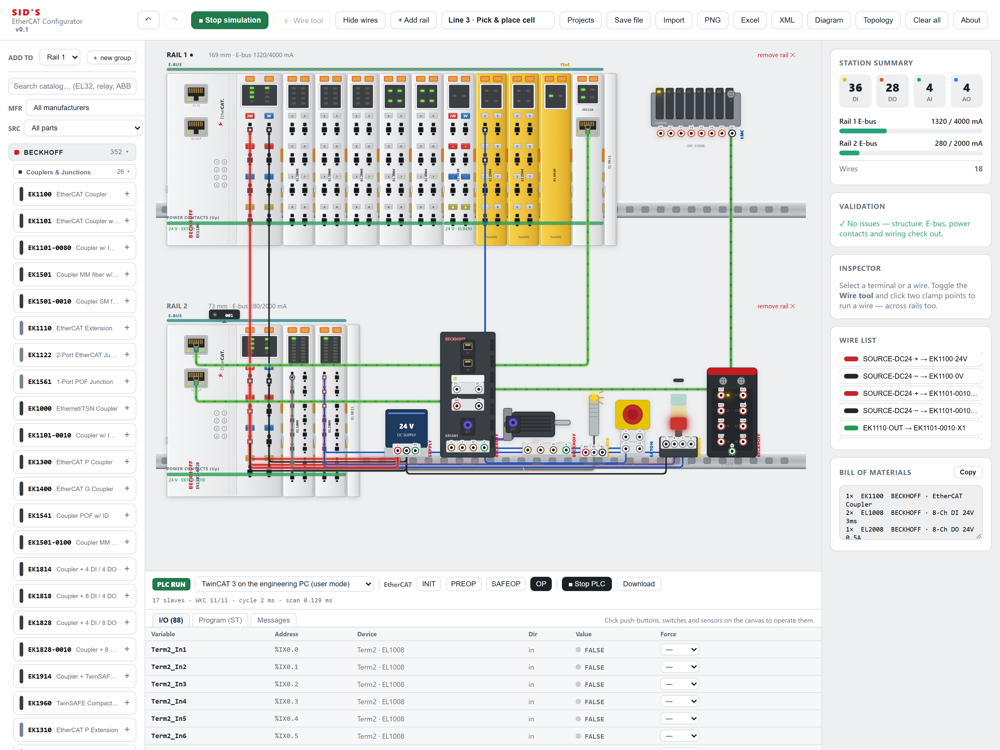

**Electrical connection diagram**, exportable as PDF with a cable schedule.
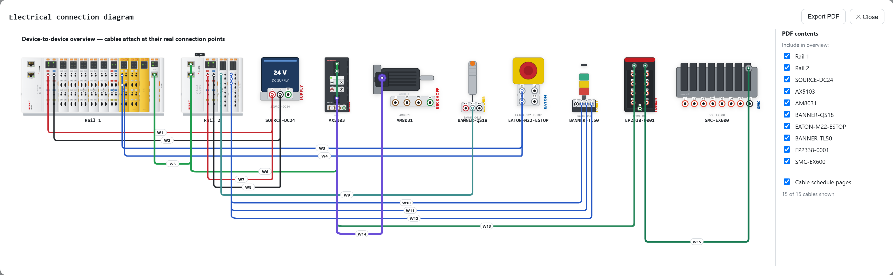

<table>
<tr>
<td width="56%" valign="top">
<b>EtherCAT topology</b> in the style of TwinCAT — E-bus and RJ45 links, a
junction drop line, and devices that are not on the network.<br><br>
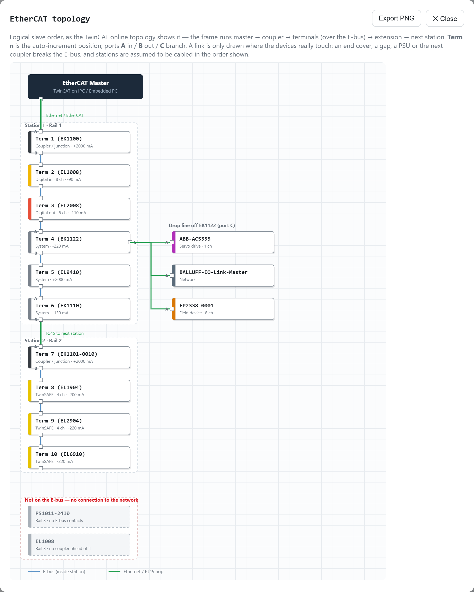
</td>
<td valign="top">
<b>Projects</b> saved in the browser, plus JSON save and import.<br><br>
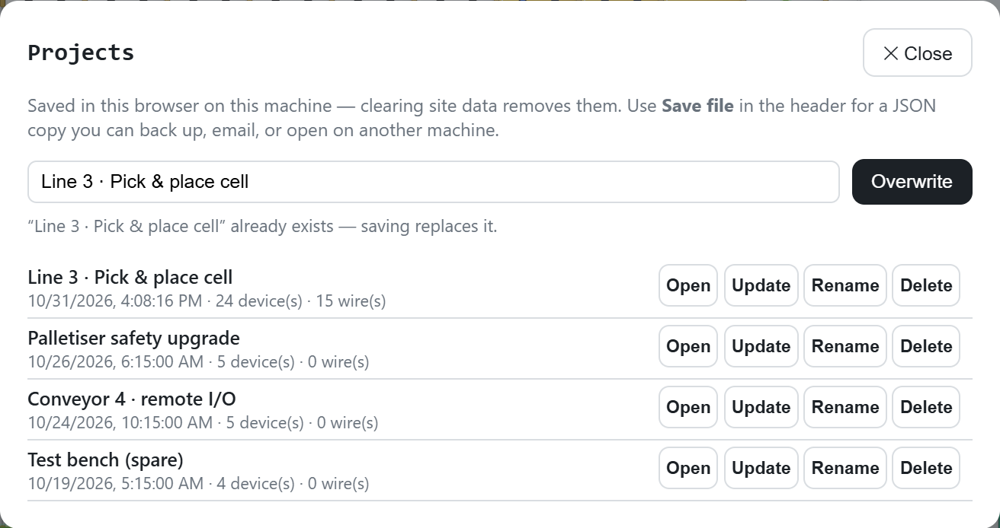<br><br>
<b>About</b> carries the licence, trademark and data-source notices inside the app.<br><br>
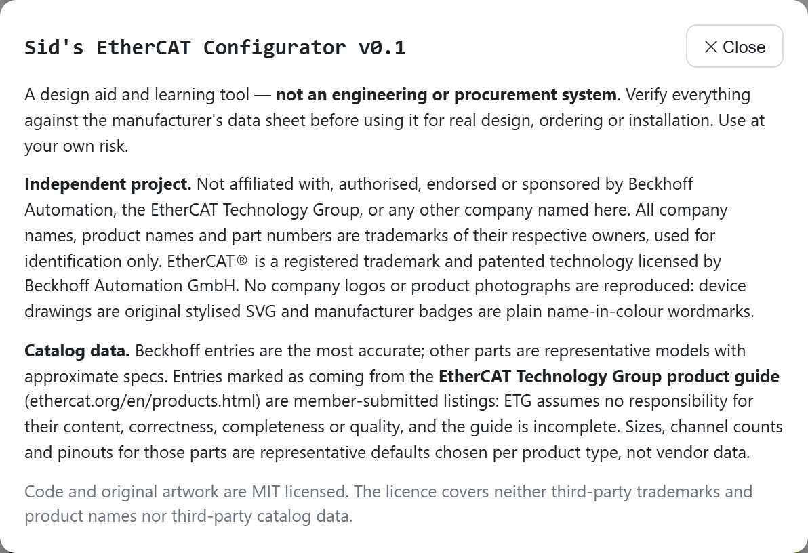
</td>
</tr>
</table>

<table>
<tr>
<td width="25%" valign="top"><b>Palette</b> by company, then category.<br><br>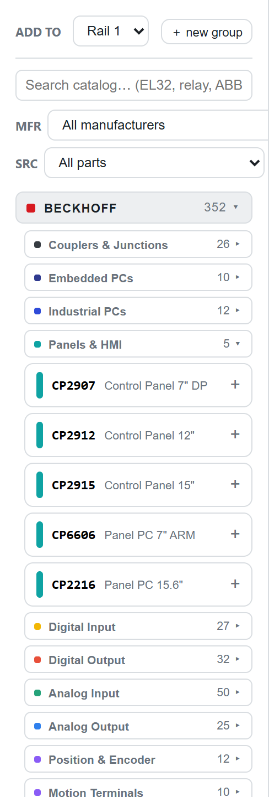</td>
<td width="25%" valign="top"><b>Search</b> — one company folder holds curated and ETG-directory parts.<br><br>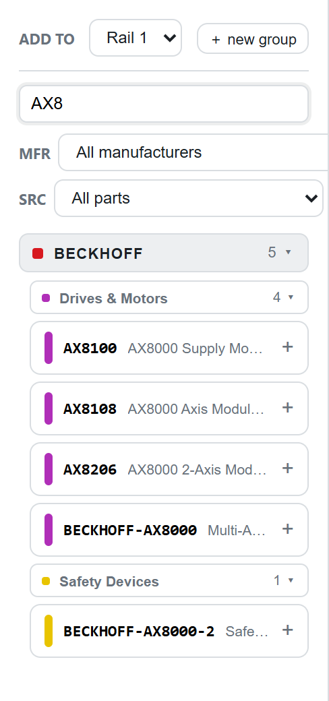</td>
<td width="25%" valign="top"><b>Directory parts</b> say what is real and what is a default.<br><br>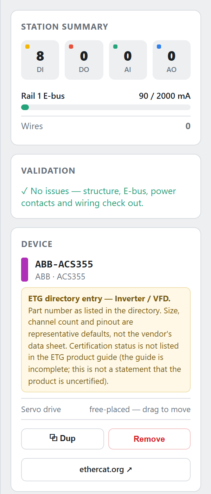</td>
<td width="25%" valign="top"><b>Validation</b> catches structure and E-bus problems, with the fix.<br><br>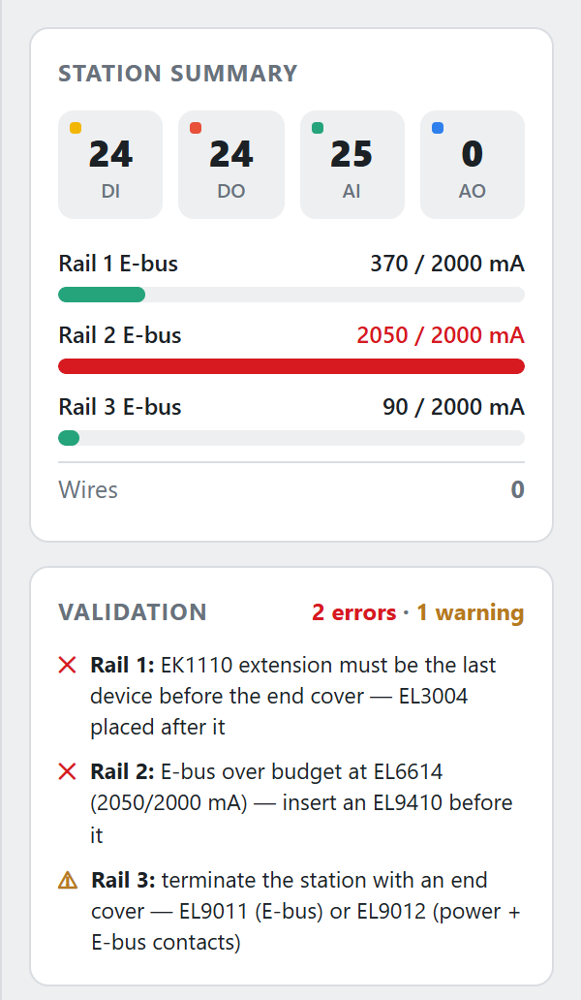</td>
</tr>
</table>

---

## Quick start

**Just want to use it?** Download **`Sids-EtherCAT-Configurator.html`**
from this repo and double-click it. It runs fully offline in any modern
browser (Chrome, Edge, Firefox, Safari). Your work autosaves in the
browser; use **Projects** to keep named designs in the browser, or
**Save file / Import** to move a design between machines as JSON. The
**About** button in the app carries the same notices as this README.

**Want to develop it?**

```bash
npm install
npm run dev      # dev server with hot reload
npm run build    # bundles everything into dist/index.html (self-contained)
```

### Regenerating screenshots

```bash
npm run shots                          # every scene -> docs/images/ (2x, retina-sharp)
npm run shots -- --only hero,topology  # just those
npm run shots -- --labels hero         # list the connection points a scene can wire
npm run shots -- --headed              # watch it drive the app
```

`scripts/shots/scenes.mjs` describes each scene as data: a design to load,
then steps that drive the real interface — the wire tool (which picks every
cable itself), header buttons, palette search and filters — and the region to
capture. It runs against the built `Sids-EtherCAT-Configurator.html` through
your installed Edge (`--browser chrome` for Chrome), refuses to run if that
build is older than `src/`, and fails a scene outright if any wire it asks for
is rejected, so the images can't silently drift from the app.

The build inlines all JS/CSS into one HTML file
(`vite-plugin-singlefile`), which is what makes the standalone file work
from a `file://` URL. After building, copy it to the repo root:

```bash
cp dist/index.html Sids-EtherCAT-Configurator.html
```

## Features

- **~1,550-part catalog across 281 manufacturers**, all connectable:
  - ~660 hand-curated parts from 22 manufacturers — couplers,
    embedded/industrial PCs, panels, drives & motors, the full Beckhoff
    EL/EP terminal families, plus representative sensors, operators,
    contactors/breakers, disconnects, power supplies, distribution,
    safety devices, pneumatics, IP67 I/O and IO-Link masters;
  - 893 devices listed in the **EtherCAT Technology Group product guide**
    (drives, I/O systems, sensors, gateways, FSoE safety devices, valve
    manifolds, panels) — see [Data sources](#data-sources--attribution).
- **Palette by company → category** (Couplers, Digital Input, Drives &
  Motors, Sensors, Signaling…), with manufacturer and source filters and a
  search that matches part number, name, manufacturer and device type.
- **Smart wiring** — press two connection points and the correct cable is
  chosen automatically from what they are; incompatible pairs are blocked.
- **Cable highlighting** — EtherCAT cables glow, Safety-over-EtherCAT
  (FSoE) blinks yellow, IO-Link blinks blue.
- **Validation** — rail structure, E-bus & power-contact budgets,
  potential groups, PSU sizing, Hot-Connect IDs, and wiring faults.
- **EtherCAT topology view** in the style of the TwinCAT online topology,
  drawing a link only where devices physically touch.
- **Simulate** *(v0.2-dev)* — runs the design as a live EtherCAT station:
  a TwinCAT, CODESYS or Omron Sysmac master (EtherCAT masters only), an ST
  program, INIT→OP state machine, forcing, and a 24 V circuit solver behind
  every LED, lamp, coil and short circuit. See [FEATURES §11](FEATURES.md#11-simulate-v02-dev).
- **Projects** — named saves in the browser, plus JSON save/import.
- **Exports** — Excel BOM (spreadsheet), PDF wiring diagram, PNG of the
  panel and of the topology, and a TwinCAT-style XML device list.

See **[FEATURES.md](FEATURES.md)** for the full list and roadmap.

## Repository layout

```
Sids-EtherCAT-Configurator.html   prebuilt standalone app (the deliverable)
index.html                        Vite entry
src/
  App.jsx                         UI, geometry, faces, wiring, exports
  catalog.js                      core parts + category groups
  catalog-extended.js             bulk catalog expansion
  catalog-etg.js                  GENERATED from the ETG product guide
  validate.js                     station & wiring validation
  sim/                            Simulate: station, circuit solver, PLC glue, panel
  plcsim/                         PLC engine vendored from PLCSIM (EtherCAT-only)
  main.jsx
scripts/
  gen-etg.py                      regenerates src/catalog-etg.js
  shots/                          screenshot automation (shoot.mjs + scenes.mjs)
docs/images/                      generated screenshots + shots.json manifest
package.json  vite.config.js
LICENSE  NOTICE  FEATURES.md  HANDOFF.md  CLAUDE.md
```

`HANDOFF.md` is the developer's deep-dive (architecture, data model, and
the gotchas that have already caused bugs). `CLAUDE.md` mirrors the key
conventions.

## Tech

Vite + React (single-file build), jsPDF for the diagram PDF. Everything
renders as original SVG. No backend.

## Status & accuracy

This is a design-aid and learning tool, **not** an engineering or
procurement system.

- **Beckhoff** data is the most accurate; several values were checked
  against Beckhoff's public documentation.
- **Other hand-curated** parts are *representative* real model families
  with **approximate** electrical specs.
- **ETG product-guide** parts are the loosest: vendor, product name,
  listing category, certification listing and link are taken from the
  guide, but the guide carries no electrical data, so their sizes,
  channel counts and pinouts are **representative defaults per product
  type**. Many listings are product families rather than orderable part
  numbers, and the app marks those.
- Component drawings are original **stylized** SVG, not renders of
  specific products.

Verify everything against the manufacturer's datasheet before using any
of it for real design, ordering or installation.

## Data sources & attribution

893 catalog entries are derived from the **EtherCAT Technology Group
(ETG) product guide** at
[ethercat.org/en/products.html](https://www.ethercat.org/en/products.html).
Listings in that guide are submitted by ETG member companies. Per ETG's
[Guidelines for the EtherCAT Product Guide](https://www.ethercat.org/download/documents/EtherCAT_Product_Guide_Guidelines_EN.pdf),
ETG assumes no responsibility for the content, correctness, completeness
or quality of that material, and liability lies with the member company.
The guide is also, by ETG's own description, incomplete.

What that means here:

- Only identification data is used: company, product name, listing
  category and type, the certification listing, and a link back to the
  ETG page. No product texts, photos or graphics from the guide are
  reproduced.
- "Listed as certified in the ETG product guide" reports the guide's
  listing at the time of export. Where no certification is listed, the app
  says only that — it is **not** a statement that a product is
  uncertified.
- **The source export is not redistributed in this repository.** ETG holds
  only a non-transferable right to publish member listings, so they are
  not ours to relicense. `scripts/gen-etg.py` documents how to regenerate
  `src/catalog-etg.js` from your own export.
- The ETG data is not covered by this project's MIT licence — see
  [NOTICE](NOTICE).

## Trademarks & disclaimer

This project is an independent, non-commercial tool and is **not
affiliated with, authorized, endorsed by, or sponsored by** Beckhoff, the
EtherCAT Technology Group, or any other company named in the catalog.

All company names, product names, and part numbers (Beckhoff, EtherCAT®,
TwinCAT, TwinSAFE, WAGO, Murr Elektronik, Banner, Eaton, Balluff, SMC,
Festo, igus, Leuze, Siemens, Phoenix Contact, SICK, Turck, ifm, Pilz,
Schneider Electric, Kollmorgen, Omron, AutomationDirect, Weidmüller, the
further manufacturers listed in the ETG product guide, and others) are
**trademarks or registered trademarks of their respective owners**, used
here **for identification and interoperability reference only**.
EtherCAT® is a registered trademark and patented technology licensed by
Beckhoff Automation GmbH.

No company logos or product photographs are reproduced. Manufacturer
"badges" in the app are plain name-in-color wordmarks for identification.
Part numbers and specifications are representative and may be inaccurate.

Use at your own risk. See [LICENSE](LICENSE) (MIT) for the terms covering
the original code and artwork, and [NOTICE](NOTICE) for what it does not
cover.
